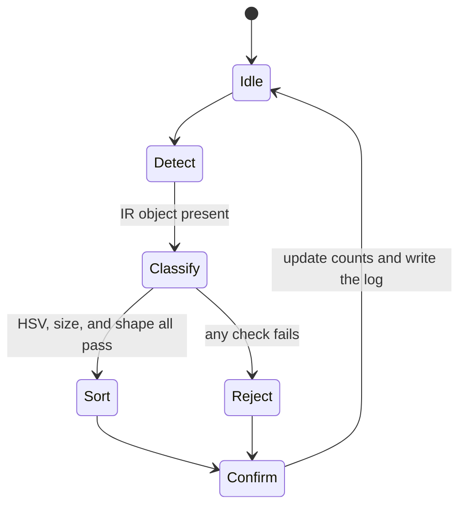

# Group 20 — Automated Object Sorting System

LabVIEW-controlled sorting cell for ENG20010 (Robotics & Mechatronics). Uniform RGB cubes get funneled onto a singulating conveyor belt, an IR sensor detects them, a USB camera classifies colour, size, and shape, and an SG90 servo diverter sorts each object by colour or rejects them.

Repository: https://github.com/JaymondAU/LabViewObjectSorter

Demo target: mixed batch, at most 10 s per object, at least 90% correct binning under controlled lighting, with a TCP/IP remote start/stop/mode client.

## How to get the code

Each person clones this repository onto their **own computer**.

```bash
git clone https://github.com/JaymondAU/LabViewObjectSorter.git
```

Before every work session:

```bash
git pull
```

After you save in LabVIEW:

```bash
git add labview
git commit -m "Describe the VI you changed and why"
git push
```

Say in the group chat which file you are opening, and say when it is free. Two people must not edit the same `.vi` at the same time.

## LabVIEW projects

Two projects are already in the repository. Open the one that matches the machine you are on. Everyone uses LabVIEW 2026.

| Project | Path | What it is |
| --- | --- | --- |
| Sorter cell | `labview/ObjectSorter/ObjectSorter.lvproj` | State machine, vision, DAQ, SCADA, and the TCP server |
| Remote client | `labview/RemoteClient/RemoteClient.lvproj` | Second-PC TCP client for live data and start/stop/mode |

**Separate compiled code from source file** is already enabled on both projects. LabVIEW then stores compiled code outside each `.vi`. Running a VI no longer changes the file when the diagram did not. Leave that setting on. If you add a VI another way and LabVIEW offers to store compiled code inside the file, choose separate compiled code before the first commit of that VI.

`ObjectSorter.lvproj` contains an auto-populating folder for each owned directory: `StateMachine`, `Typedefs`, `Vision`, `DAQ`, `SCADA`, and `Network`. Save new VIs into your folder. LabVIEW adds them to the project on save, which also updates `ObjectSorter.lvproj`. Commit that project file in the same commit as the new VI.

`Remote_Client.vi` belongs only in `RemoteClient.lvproj`.

## Who owns which files

`.vi` files are binary. Git can keep history and roll back, but it cannot merge two edits of the same VI. Stay inside your folder.

| Person | Role | Folder | Planned VIs |
| --- | --- | --- | --- |
| Nathan Do | LabVIEW core | `labview/ObjectSorter/StateMachine/` and `Typedefs/` | `Main_State_Machine.vi`, `System_State.ctl`, `Object_Class.ctl` |
| Taigue Mitchell | Vision | `labview/ObjectSorter/Vision/` | `Acquire_Frame.vi`, `Classify_Colour_HSV.vi`, `Measure_Size.vi`, `Measure_Shape.vi`, `Classify_Object.vi` |
| Jasper Van Eijk | DAQ and actuation | `labview/ObjectSorter/DAQ/` | `Read_IR_Presence.vi`, `Set_Servo_Position.vi` |
| Taha Mohamed Shaik | SCADA, logging, network | `labview/ObjectSorter/SCADA/`, `Network/`, and `labview/RemoteClient/` | `Update_Dashboard.vi`, `Log_Production.vi`, `TCP_Publish_Status.vi`, `TCP_Listen_Commands.vi`, `Remote_Client.vi` |
| Jaymond Martin | Group lead | `N/A` | `N/A` |

Nathan wires the sub-VIs into the state machine. Call into someone else's VI; do not edit their diagram. If a connector pane must change, agree in chat first, because every caller breaks until it is updated.

Agreed servo setpoints (50 Hz PWM, confirm on hardware): Reject near 0°, Red near 60°, Green near 120°, Blue near 180°.

## State machine

The main VI must be a state machine (enum typedef, case structure, shift register). The scope requires these states:



- **Detect** waits for the IR sensor, then triggers a frame capture.
- **Classify** checks HSV colour, bounding-box area, and aspect ratio. Any failed check selects Reject.
- **Sort** and **Reject** command the matching servo setpoint.
- **Confirm** updates per-bin and reject counts and appends a time-stamped log line, then returns to Idle.

## If Git reports a conflict on a VI

Do not open the conflicted `.vi` in a text editor. Tell the group. Keep one person's file, and the other person replays their change on that copy. A text merge will destroy the VI.

`.lvproj` is XML and can sometimes be merged, but if both people added items, open the project in LabVIEW afterwards and confirm every VI still resolves.

## What not to commit

`.aliases`, `.ali`, and `.lvlps` are local LabVIEW settings and are already ignored. `labview/ObjectSorter/.ObjectSorter.UserState/` is also ignored: LabVIEW rewrites it every time the project is opened, and `git add labview` will skip it. The unit scope and project brief stay on your own machines; they are not in this repository.
