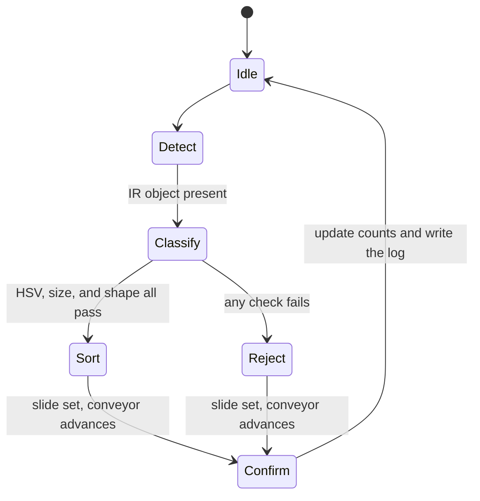

# Group 20 - Automated Object Sorting System

LabVIEW-controlled sorting cell for ENG20010 (Robotics & Mechatronics). Cubes leave a funnel onto an inclined conveyor, get classified at the bottom of the belt, then fall onto a servo-pivoted slide that routes them by colour or to Reject.

Repository: https://github.com/JaymondAU/LabViewObjectSorter

Demo target: mixed batch, at most 10 seconds per object, at least 90% correct binning under controlled lighting, with a TCP/IP remote start/stop/mode client.

## Cell

Cubes sit in a funnel that feeds an inclined conveyor. Dividers on the belt overlap the funnel outlet, so each divider agitates the outlet and lets one object onto the belt. The IR sensor and USB camera sit at the bottom of the conveyor. Classification happens there, while the object is still on the belt. The conveyor then advances and the object falls off the end onto a slide. An SG90 pivots that slide to the Red, Green, Blue, or Reject bin.

## How to get the code

Each person clones this repository onto their **own computer**.

```bash
git clone https://github.com/JaymondAU/LabViewObjectSorter.git
```

Before every work session:

```bash
git pull
```

After you save in LabVIEW:

```bash
git add labview
git commit -m "Describe the VI you changed and why"
git push
```

Say in the group chat which file you are opening, and say when it is free. Two people must not edit the same `.vi` at the same time.

## LabVIEW projects

Two projects are already in the repository. Open the one that matches the machine you are on. Everyone uses LabVIEW 2026.

| Project | Path | What it is |
| --- | --- | --- |
| Sorter cell | `labview/ObjectSorter/ObjectSorter.lvproj` | State machine, vision, DAQ, SCADA, and the TCP server |
| Remote client | `labview/RemoteClient/RemoteClient.lvproj` | Second-PC TCP client for live data and start/stop/mode |

**Separate compiled code from source file** is already enabled on both projects. LabVIEW then stores compiled code outside each `.vi`. Running a VI no longer changes the file when the diagram did not. Leave that setting on. If you add a VI another way and LabVIEW offers to store compiled code inside the file, choose separate compiled code before the first commit of that VI.

`ObjectSorter.lvproj` contains an auto-populating folder for each owned directory: `StateMachine`, `Typedefs`, `Vision`, `DAQ`, `SCADA`, and `Network`. Save new VIs into your folder. LabVIEW adds them to the project on save, which also updates `ObjectSorter.lvproj`. Commit that project file in the same commit as the new VI.

`Remote_Client.vi` belongs only in `RemoteClient.lvproj`.

## Who owns which files

`.vi` files are binary. Git can keep history and roll back, but it cannot merge two edits of the same VI. Stay inside your folder.

| Person | Role | Folder | VIs |
| --- | --- | --- | --- |
| Nathan Do | LabVIEW core | `labview/ObjectSorter/StateMachine/` and `Typedefs/` | State machine: `Main_State_Machine.vi`, `Globals.vi`. Typedefs: `System_State.ctl`, `Motor_Command.ctl`, `ServoCommand.ctl` |
| Taigue Mitchell | Vision Handling | `labview/ObjectSorter/Vision/` | `camera system.vi` |
| Jasper Van Eijk | DAQ and actuation | `labview/ObjectSorter/DAQ/` | `QueryIR.vi`, `MotorController.vi`, `ServoController.vi` |
| Taha Mohamed Shaik | SCADA, logging, TCP networking | `labview/ObjectSorter/SCADA/`, `Network/`, and `labview/RemoteClient/` | Not in the repo yet: `Update_Dashboard.vi`, `Log_Production.vi`, `TCP_Publish_Status.vi`, `TCP_Listen_Commands.vi`, `Remote_Client.vi` |
| Jaymond Martin | Group lead | `N/A` | `N/A` |

Nathan wires the sub-VIs into the state machine. Call into someone else's VI; do not edit their diagram. If a connector pane must change, agree in chat first, because every caller breaks until it is updated.

Agreed servo setpoints (50 Hz PWM, confirm on hardware): Reject near 0°, Red near 60°, Green near 120°, Blue near 180°.

## State machine

The main VI must be a state machine (enum typedef, case structure, shift register). The scope requires these states:



- **Detect** waits until the IR sensor at the bottom of the conveyor sees an object, then triggers a frame capture.
- **Classify** checks HSV colour, bounding-box area, and aspect ratio in `camera system.vi`. Any failed check selects Reject.
- **Sort** and **Reject** move the slide to the matching servo setpoint, then advance the conveyor so the object falls off the end onto the slide.
- **Confirm** updates per-bin and reject counts and appends a time-stamped log line, then returns to Idle.

## If Git reports a conflict on a VI

Do not open the conflicted `.vi` in a text editor. Tell the group. Keep one person's file, and the other person replays their change on that copy. A text merge will destroy the VI.

`.lvproj` is XML and can sometimes be merged, but if both people added items, open the project in LabVIEW afterwards and confirm every VI still resolves.

## What not to commit

`.aliases`, `.ali`, and `.lvlps` are local LabVIEW settings and are already ignored. So are the user-state folders LabVIEW writes beside each project: `labview/ObjectSorter/.ObjectSorter.UserState/` and `labview/RemoteClient/.RemoteClient.UserState/`. LabVIEW rewrites those every time a project is opened, and `git add labview` will skip them. The unit scope and project brief stay on your own machines; they are not in this repository.

# How to run

1. Download repository
2. Install latest version of NI labview
3. Install NI Vision Acquisition Software if not already installed
4. Attach external components to the NI-mydaq according to the table below

    | Pin | Device |
    | --- | --- |
    | DIO 7 | Manual LED (OUPUT) |
    | DIO 6 | Sort LED (OUTPUT) |
    | DIO 5 | Classify LED (OUTPUT) |
    | DIO 4 | Idle LED (OUTPUT) |
    | DIO 3 | Servo motor signal (PWM pin, OUTPUT) |
    | DIO 2 | E stop button (INPUT) |
    | DIO 1 | Motor sleep (on motor controller, OUTPUT) |
    | DIO 0 | IR sensor signal (INPUT) |
    | AIO 1 | Motor control input 2 (OUTPUT) |
    | AIO 0 | Motor control input 1 (OUTPUT) |
    | COM | USB camera (Can be plugged into any COM port) |

5. Run Application.exe

   All data logger files are located in C:\TEMP\datalogger.txt

# External Links

Repository Download - https://github.com/JaymondAU/LabViewObjectSorter/tree/main

NI Labview - https://www.ni.com/en/support/downloads/software-products/download.labview.html?srsltid=AYCX9vKaZAnpzRqCNb7ctTADVanc-FMCQGi2oKgKwGJ73uAx7-ccAtVA#607174

NI Vision Acquisition Software - https://www.ni.com/en/support/downloads/drivers/download.vision-acquisition-software.html?srsltid=AYCX9vJWepiRWzv9_2NQyDnCgH1PVaW0IhJumfOW3IpQZE-mQ1eqdVTX#616456

# Project Structure
```
labview\
├── ObjectSorter\                           Sorting system controller and data server
│   ├── DAQ\
│   │   ├── MotorController.vi              Conveyor motor behaviour
│   │   ├── MotorTest.vi                    Tests conveyor motor
│   │   ├── PanelController.vi              Controls the LED Panel
│   │   ├── QueryIR.vi                      Assistant for object detection
│   │   └── ServoController.vi              Servo motor behaviour
│   │
│   ├── Network\
│   │   ├── CurrentServer.vi                Previous Working server
│   │   ├── ModernNetworkStreamer.vi        One way data stream to client
│   │   ├── TCP server.vi                   Prototype TCP server
│   │   └── TCP server2.vi                  Prototype One-way TCP server
│   │
│   ├── SCADA\
│   │   └── SCADA.vi                        Server-side SCADA layout
│   │
│   ├── StateMachine\
│   │   ├── Globals.vi                      Server-side Global variables
│   │   ├── Main_State_Machine.vi           State machine
│   │   └── State machine(rough).vi         Previous state machine
│   │
│   ├── TypeDefs\
│   │   ├── BeltControl.ctl                 Stores variables for conveyor belt
│   │   ├── ServoCommand.ctl                Stores variables for servo
│   │   └── System_State.ctl                Stores variables for state machine
│   │
│   ├── Vision\
│   │   ├── camera system compressed.vi     Obsolete camera capture system
│   │   └── Jay'sCameraSystem.vi            Current camera capture system
│   │
│   └── ObjectSorter.lvproj                 Server Project file
│
├── RemoteClient\                           Remote Client that connects to Sorting System
│   ├── clientSCADA\
│   │   └── SCADA.vi                        Client-side SCADA layout
│   │
│   ├── clientTCP\
│   │   ├── GetCameraFeed.vi                Receives camera feed from server   
│   │   └── TCP client.vi                   Client side code for TCP
│   │
│   ├── Variables\
│   │   └── ComGlobalVars.vi                Stores variables for communication
│   │
│   └── RemoteClient.lvproj                 Client Project file
│
├── TestRemoteClient\                       Test Client
│   ├── Variables\
│   │   ├── TCPGlobalVars.vi                Stores variables for communication testing
│   │   ├── TCPSharedVariables.vi           Stores variables for communication testing
│   │   └── TCPSCADA.vi                     SCADA testing VI
│   │
│   ├── TestRemoteClient.lvproj             Test Client Project file
│   └── README.md
│
└── README.md                               This file    
```